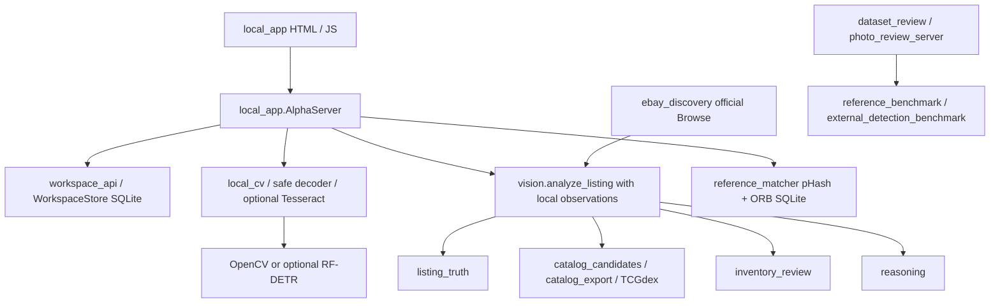

# Existing system audit — 2026-10-15

Audit completed before this increment's implementation. Baseline: local checkout of
`7dbe3398`, branch `feature/pokemon-deal-reasoning-v1`, with the prior local RF-DETR
and launcher fixes preserved. New dedicated branch: `feature/graded-unique-supply`.
GitHub PR #1 was verified open and draft, with that same head SHA. No merge/deploy.

## Evidence and reusable components

| Feature | Status | Reuse / limitations |
|---|---|---|
| Local app + durable workspace | Verified working in automated integration tests | `local_app.AlphaServer`, `analyze_request`; `workspace.WorkspaceStore`; loopback/origin controls, SQLite transactions, analysis JSON |
| Deal reasoning / scenarios | Verified working on fixtures | `reasoning.evaluate_deal`, `workspace.scenario`; no live sold-price evidence |
| Listing Truth | Verified working on fixtures | `listing_truth.extract_claims`, `evaluate_listing_truth`; preserves negated claims, no cert reader |
| Local geometry and OCR | Partial | `local_cv._checked_image`, `detect_card_boxes`, `_ocr_card`; Tesseract executable absent, no measured real OCR accuracy |
| pHash/ORB reference matching | Verified on synthetic fixtures | `reference_matcher.features`, `ReferenceMatcher`; no real reference library configured |
| Exact catalog / TCGdex | Partial | `catalog_export.export_catalog`, `catalog_candidates.CatalogCandidateIndex`; current exporter English only, candidate normalization strips Japanese |
| Photo Ground Truth Lab | Verified on fixtures | `dataset_review.PhotoReviewStore`, `photo_review_server`; designed for card identity/boxes, no graded certificate benchmark dataset |
| Lot / collection reconciliation | Verified on fixtures | `inventory_review.review_inventory`; cross-photo review groups are not certificate-level supply counts |
| eBay Discovery | Partial | `ebay_discovery.discover`, `listing_from_ebay`; official production Browse, one page, legacy credentials, no persistent token cache; tests mock network |
| RF-DETR | Partial, optional experiment | `RFDETRCardDetector`, `train_rfdetr_card`, `compare_reports`; trusted checkpoint gate, paired hashes; no trained weights or slab-label dataset |
| Certificate extraction / unique supply | Missing at baseline | Dedicated evidence and conflict handling required |
| Paid vision | Partial | `vision.call_vision_api`; explicit CLI invocation but no daily/monthly ledger; local app supplies local observations and does not call it |
| Deployment | Existing public radar and local alpha | `.github/workflows/pokemon-detector.yml` publishes legacy radar on main. New work must not dispatch it. Local alpha has no SaaS authentication |

## Dependency map

## Baseline measurements

`python -m unittest discover -s tests -v`: 265 tests in 12.871 seconds,
263 passed, 2 skipped (Windows symlink privilege). No failures.
This is suite wall time, not image latency. No independent labeled certificate
images are available, therefore certificate accuracy, duplicate precision on
real inventory, RF-DETR speed and local-resolution rate are **unmeasured**.
GPU installation was previously tested; this audit does not infer model accuracy
from CUDA availability. No certificate deduplicator exists to benchmark at baseline.

## Security and data

Workspace SQLite already stores listings, events, scenarios, trades and feed
imports; extend this database for snapshots rather than introduce a new service.
Images are bounded (5 MiB, 12 million pixels), uploads transient. Private files
and venv ignored. Environment variable names checked without printing values:
no eBay/Scrydex/Vision credential variables available to this process.
GitHub credentials are not eBay API permissions. `.env` ignore coverage needs adding.
Existing arbitrary-host image URL validation is syntactic; do not add a downloader
without DNS/redirect protections. No external image downloads needed this increment.

## Prioritized gaps

1. Unicode-safe graded identity and exclusion policy; retain ambiguous candidates.
2. Local certificate reader with original evidence and explicit unavailable OCR.
3. Certificate evidence gate, conflicting records quarantine, conditional supply bounds.
4. Bounded official eBay search and visible incomplete coverage.
5. Same-database snapshots and a usable local graded search interface.
6. Real annotated 50-image dataset, working OCR executable, API credentials and
   rights review are prerequisites to real-world acceptance. Unit fixtures do not satisfy them.
